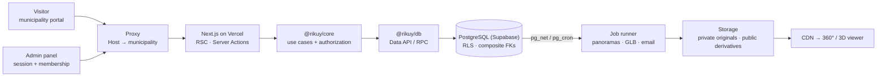

# Rikuy

**A multi-municipality SaaS platform for immersive tourism.** Each municipality gets its own portal, under its own brand and address, with places to visit, an events calendar, a map, 360° virtual tours and 3D models, and manages it from a central admin panel. Every municipality runs on the same deployment: onboarding a new one requires no code changes.

> _Rikuy_ means "to see, to look" in Quechua.

[Español](README.md) · **English**

[](https://github.com/jorgesolizvidal/rikuy/actions/workflows/ci.yml)
[](https://github.com/jorgesolizvidal/rikuy/actions/workflows/daily-health.yml)

## Try it live

| What                             | Address                                                                                  | What to look at                                                                     |
| -------------------------------- | ---------------------------------------------------------------------------------------- | ----------------------------------------------------------------------------------- |
| Demo portal                      | [rikuy-demo-norte.vercel.app](https://rikuy-demo-norte.vercel.app)                       | Places, events, the map with "Use my location", and the 360° tours                  |
| A 360° tour                      | [Mirador del Valle](https://rikuy-demo-norte.vercel.app/destinos/mirador-del-valle/tour) | Two scenes linked by arrows, a 3D model loaded on demand and a jump to another tour |
| General tour                     | [/recorrido](https://rikuy-demo-norte.vercel.app/recorrido)                              | Every tour of the municipality in a single viewer, with the "Tours" menu            |
| Another municipality, same build | [rikuy-demo-sur.vercel.app](https://rikuy-demo-sur.vercel.app)                           | A different brand, colors and content, without a single line of different code      |
| Ucureña                          | [rikuy-ucurena.vercel.app](https://rikuy-ucurena.vercel.app)                             | The first real municipality, being prepared: its content is loaded from the panel   |

The admin panel ([rikuy-app-admin.vercel.app](https://rikuy-app-admin.vercel.app/login)) is invitation-only: there is no public sign-up.

> The demo portals use synthetic data. Each municipality uploads its real photos and panoramas from its panel.

The interface is in Spanish, the language of the municipalities it serves.

## What it does

**For visitors (public portal, installable PWA):**

- Places to visit and an events calendar with full pages, directions, "Add to calendar" (.ics), sharing and a QR code for each place.
- A map of every place with an accessible list of the same places, updated as the map moves.
- Real-time location: distances, "sort by nearest" and a "You are near…" notice. Everything is computed on the phone; the position never reaches the server.
- 360° tours with four kinds of points (information with photos, go to another scene, 3D model, go to another tour) and a general tour that jumps between tours without leaving the viewer.
- 3D models that download only when asked for, with an image and a description as an alternative.
- The tour also as text, for screen readers and phones without WebGL.

**For the municipality (admin panel):**

- Its own versioned brand: name, colors with checked contrast, logo, contact details, SEO and app icons.
- Editorial publishing: draft → publish → roll back to any earlier version, with an audit trail.
- A tour editor: scenes, starting view, points placed on the panorama, the general tour's order, and QR codes.
- Panorama (up to 16K) and GLB uploads, processed in the background: tiling, Meshopt compression and KTX2 textures with a color check.
- Members with roles (owner, admin, editor, analyst), email invitations, and storage and processing quotas.

**For the platform operator:** onboarding municipalities behind two-factor authentication, sales demos with generated sample content, a job queue with retries, and the platform's status (storage, database, jobs and quotas).

## Status

Phases P1 to P4 are done: foundation, media, portal and tours. The current milestone is **Demo / Portfolio**: Ucureña ready for its content, sales demos, running on free plans, and this README. Next is **P5**: an AI tourist assistant (one conversation across the portal and the tours, with cited sources and voice). Details in the [roadmap](docs/roadmap.md) and the [checkpoint](docs/progress/CHECKPOINT.md) (in Spanish).

## Architecture



- **A municipality is recognized by its address, on the server.** The proxy reads only the `Host` and looks it up in a domain registry. An unknown host or a suspended municipality gets a 404 or a 503: there is no default municipality. No municipality is written in the code; it is all data.
- **Isolation in the database.** Every row carries `tenant_id`, relations use composite foreign keys `(tenant_id, id)`, and Row Level Security filters by the current membership. Every migration ships with pgTAP tests that include negative cases: a user of one municipality asking for another's data, a revoked role, or a visitor reading drafts.
- **Strict layers.** UI → HTTP adapter → use case in `@rikuy/core` (framework-free, enforced by ESLint) → repository in `@rikuy/db`. Operations that touch several tables (publishing, inviting, reserving quota) are a single transaction inside a database function.
- **Publishing seals.** Content and tours are edited in a draft; publishing makes the revision immutable, together with its manifest. Rolling back means pointing to another sealed revision.
- **Durable jobs without a server of their own.** A PostgreSQL ledger with leases and fencing tokens. The database wakes the runner on Vercel (`pg_net` on enqueue, `pg_cron` as a fallback), which works through its own role, without the service key.
- **Cache per municipality.** Portal pages are cached at the CDN per host; publishing invalidates only that municipality's pages.
- **Performance as a contract.** 3D viewers, maps and heavy libraries load through dynamic imports; CI fails when a page breaks its budget.

More in [architecture](docs/architecture.md) (in Spanish).

## Key decisions

All 35 decisions are recorded as ADRs ([index](docs/adr/README.md), in Spanish). Some of them:

| ADR                                                        | Decision                                                                                      |
| ---------------------------------------------------------- | --------------------------------------------------------------------------------------------- |
| 003 · 015                                                  | Shared tables with `tenant_id` and RLS; the municipality is resolved from a registered domain |
| [020](docs/adr/ADR-020-panorama-delivery-by-resolution.md) | Panoramas: a single image up to 4096 px, tiled levels above that, and a preview ≤ 40 KB       |
| [021](docs/adr/ADR-021-visitor-location.md)                | The visitor's location is computed on the device and never stored                             |
| [024](docs/adr/ADR-024-portal-page-cache.md)               | Page cache per municipality (ISR), invalidated on publish                                     |
| [025](docs/adr/ADR-025-job-runner-wake-up.md)              | The database wakes the job runner (Vercel Hobby's cron runs once a day)                       |
| [026](docs/adr/ADR-026-glb-pipeline.md)                    | 3D models with Meshopt and KTX2, with colors compared before and after                        |
| [027](docs/adr/ADR-027-usage-quotas.md)                    | Per-municipality quotas with atomic reservations and real measurement in Storage              |
| [030](docs/adr/ADR-030-tour-publication.md)                | Publishing a tour copies its public media first, then seals                                   |
| [033](docs/adr/ADR-033-tour-models.md)                     | In a tour, a 3D model is an image first; the viewer and the GLB load only on request          |
| [035](docs/adr/ADR-035-free-plan-operations.md)            | Running on free plans: a daily check, email alerts and automatic cleanup                      |

## Real numbers

**Lighthouse on production** (October 31, 2026, simulated mobile with 4G and 4× CPU slowdown, median of 3 runs):

| Page                     | Performance | LCP       | Accessibility · Best practices · SEO |
| ------------------------ | ----------- | --------- | ------------------------------------ |
| Home                     | 98–99       | 1.9–2.0 s | 100 · 100 · 100                      |
| Places and a place page  | 99–100      | 1.4–1.8 s | 100 · 100 · 100                      |
| Events and an event page | 99–100      | 1.7–1.8 s | 100 · 100 · 100                      |
| 360° tour                | 77–78       | 2.4–2.6 s | 100 · 100 · 100                      |
| Map                      | 68–69       | 2.0 s     | 100 · 100 · 100                      |

CLS is 0 on every page. Initial JavaScript is about 150 KB per page; the map and the 3D viewers download separately, only where they are used.

**On a real Android phone** (CRT-NX3, Mali-G57, 4G, in production, with the `?medir` measurement panel):

| What                                | Result                              |
| ----------------------------------- | ----------------------------------- |
| First tour scene on screen          | 1.46 s                              |
| 20 scene changes in a row           | p95 of 0.95 s, none left unfinished |
| Turning the panorama                | 87 fps, no long frames              |
| 3D model visible after "View in 3D" | 3.6 s                               |
| Map: LCP and complete view          | 1.99 s and 3.25 s                   |
| Moving the map                      | 82 fps, no frame over 50 ms         |

**Tests** (all of them on every PR):

- 506 unit tests and 790 pgTAP assertions on RLS, isolation and invariants.
- Integration against the real Supabase stack: Data API, Storage, queues, email and a per-role access matrix.
- End-to-end in a real browser:
  - portals (161 checks);
  - regression contracts RC-09/10/11/12 (189): no overflow from 360 to 1280 px, no serious axe findings, no broken links, and SEO per municipality;
  - location RC-06 (35), with the position never leaving the phone;
  - tours RC-01/07/08: full walkthroughs, late responses and the 3D viewer's memory;
  - a color comparison of the 3D models.
- Lighthouse with a budget on every PR, and on production after every merge.
- A daily check on production.

## Stack

Next.js 16 · React 19 · strict TypeScript · Supabase (PostgreSQL 17, PostGIS, Auth, Storage, pg_cron, pg_net, Vault) · Photo Sphere Viewer 5 · three.js · MapLibre + OpenFreeMap · sharp · glTF Transform (Meshopt, KTX2) · Zod · Vitest · pgTAP · Playwright · Lighthouse · axe · GitHub Actions · Vercel · pnpm monorepo.

## Running it

Requirements: Node 24, pnpm 12 and Docker Desktop (for local Supabase).

```bash
pnpm install
pnpm db:start                          # local Supabase; prints the URL and keys
cp .env.example apps/web/.env.local    # fill in the keys db:start printed
pnpm db:reset                          # migrations + synthetic data
pnpm dev
```

- Portals: [demo-norte.localhost:3000](http://demo-norte.localhost:3000) and [demo-sur.localhost:3000](http://demo-sur.localhost:3000).
- Admin panel: [app.localhost:3000](http://app.localhost:3000). Sign in as `owner@demo-norte.example.test`; the sign-in code arrives in Mailpit at [127.0.0.1:54324](http://127.0.0.1:54324).
- Platform operator: `operador@rikuy.example.test` (enrolls a second factor on the first visit).

```bash
pnpm check     # format, lint, types, tests and build (the same as CI)
pnpm db:test   # pgTAP tests
```

Deployment (Supabase, Vercel and GitHub) is described in [docs/deploy.md](docs/deploy.md) (in Spanish).

## Documentation

The documentation is in Spanish.

| Document                                         | Contents                                                  |
| ------------------------------------------------ | --------------------------------------------------------- |
| [Architecture](docs/architecture.md)             | Overview, tenancy, data, media, jobs and quotas           |
| [ADRs](docs/adr/README.md)                       | The architecture decisions and their status               |
| [Roadmap](docs/roadmap.md)                       | Phases, steps and definitions of done                     |
| [Checkpoint](docs/progress/CHECKPOINT.md)        | What each step did, how it was tested and what comes next |
| [Performance budget](docs/performance-budget.md) | Measurable loading targets                                |
| [Tour contracts](docs/contratos-tours.md)        | Evidence for contracts RC-01, 02, 07 and 08               |
| [Background jobs](docs/jobs.md)                  | How the queue works and how to diagnose it                |
| [Deployment](docs/deploy.md)                     | Setup, onboarding a municipality and daily operation      |
| [Engineering guide](CONTRIBUTING.md)             | Non-negotiable rules, conventions and definition of done  |

## Author

**Jorge Bryan Soliz Vidal**: systems engineer (Escuela Militar de Ingeniería, Cochabamba, Bolivia) and full-stack developer. Rikuy grew out of his degree project on cultural tourism in Ucureña.

[LinkedIn](https://www.linkedin.com/in/jorge-bryan-soliz-vidal-678435256/)

---

© 2026 Jorge Bryan Soliz Vidal. All rights reserved. The code is visible for portfolio purposes; no license to use, copy or distribute it is granted.
