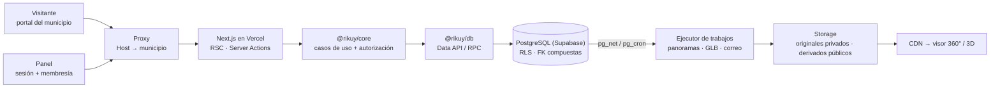

# Rikuy

**Plataforma SaaS multi-municipio de turismo inmersivo.** Cada municipio tiene su propio portal, con su marca y su dirección, con destinos, agenda, mapa, tours virtuales 360° y modelos 3D, y lo administra desde un panel central. Todos los municipios corren sobre el mismo despliegue: dar de alta uno nuevo no requiere tocar código.

> _Rikuy_ significa «ver, mirar» en quechua.

**Español** · [English](README.en.md)

[](https://github.com/jorgesolizvidal/rikuy/actions/workflows/ci.yml)
[](https://github.com/jorgesolizvidal/rikuy/actions/workflows/daily-health.yml)

## Pruébalo en vivo

| Qué                         | Dirección                                                                                | Qué mirar                                                                                     |
| --------------------------- | ---------------------------------------------------------------------------------------- | --------------------------------------------------------------------------------------------- |
| Portal de demostración      | [rikuy-demo-norte.vercel.app](https://rikuy-demo-norte.vercel.app)                       | Destinos, agenda, mapa con «Usar mi ubicación» y los tours 360°                               |
| Un tour 360°                | [Mirador del Valle](https://rikuy-demo-norte.vercel.app/destinos/mirador-del-valle/tour) | Dos escenas unidas por flechas, un modelo 3D que se abre a pedido y el salto a otro recorrido |
| Recorrido general           | [/recorrido](https://rikuy-demo-norte.vercel.app/recorrido)                              | Todos los tours del municipio en un solo visor, con el menú «Tours»                           |
| Otro municipio, mismo build | [rikuy-demo-sur.vercel.app](https://rikuy-demo-sur.vercel.app)                           | Otra marca, otros colores y otros contenidos, sin una línea de código distinta                |
| Ucureña                     | [rikuy-ucurena.vercel.app](https://rikuy-ucurena.vercel.app)                             | El primer municipio real, en preparación: su contenido se carga desde el panel                |

El panel de administración ([rikuy-app-admin.vercel.app](https://rikuy-app-admin.vercel.app/login)) es solo por invitación: no hay registro público.

> Los datos de los portales de demostración son sintéticos. Las fotos y los panoramas reales los sube cada municipio desde su panel.

## Qué hace

**Para el visitante (portal público, PWA):**

- Destinos y agenda de eventos con fichas completas, «Cómo llegar», «Añadir al calendario» (.ics), compartir y código QR por lugar.
- Mapa con todos los lugares y una lista accesible con los mismos lugares, que se actualiza al mover el mapa.
- Ubicación en tiempo real: distancias, «ordenar por cercanía» y el aviso «Estás cerca de…». Todo se calcula en el teléfono; la posición nunca llega al servidor.
- Tours 360° con cuatro tipos de puntos (información con fotos, ir a otra escena, modelo 3D, ir a otro recorrido) y un recorrido general que salta entre tours sin salir del visor.
- Modelos 3D que se descargan solo al pedirlos, con una imagen y una descripción como alternativa.
- El tour también como texto, para lectores de pantalla y teléfonos sin WebGL.

**Para el municipio (panel):**

- Marca propia versionada: nombre, colores con contraste verificado, logo, contacto, SEO e íconos de la app.
- Publicación editorial: borrador → publicar → volver a cualquier versión anterior, con auditoría.
- Editor de tours: escenas, vista inicial, puntos colocados sobre el panorama, orden del recorrido general y QR.
- Subida de panoramas (hasta 16K) y modelos GLB, procesados en segundo plano: teselas, compresión Meshopt y texturas KTX2 con verificación de color.
- Miembros con roles (propietario, administrador, editor, analista), invitación por correo y cuotas de almacenamiento y procesamiento.

**Para el operador de la plataforma:** alta de municipios con verificación en dos pasos, demos comerciales con contenido de muestra generado, cola de trabajos con reintentos y el estado de la plataforma (espacio, base de datos, trabajos y cuotas).

## Estado

Fases P1 a P4 terminadas: fundación, medios, portal y tours. Ahora corre el **Hito Demo / Portafolio**: Ucureña lista para cargar su contenido, demos comerciales, operación con planes gratuitos y este README. Sigue **P5**: el asistente turístico con IA (una conversación en el portal y en los tours, con fuentes citadas y voz). Detalle en el [roadmap](docs/roadmap.md) y el [checkpoint](docs/progress/CHECKPOINT.md).

## Arquitectura



- **Un municipio se reconoce por la dirección, en el servidor.** El proxy lee solo el `Host` y lo busca en un registro de dominios. Si el host es desconocido o el municipio está suspendido, responde 404 o 503: no hay municipio por defecto. Ningún municipio aparece escrito en el código; todo es dato.
- **Aislamiento en la base de datos.** Cada fila lleva `tenant_id`, las relaciones usan FK compuestas `(tenant_id, id)` y Row Level Security filtra por la membresía vigente. Cada migración trae tests pgTAP con casos negativos: el usuario de un municipio pidiendo datos de otro, un rol revocado o un visitante leyendo borradores.
- **Capas estrictas.** UI → adaptador HTTP → caso de uso en `@rikuy/core` (sin framework, lo impone ESLint) → repositorio en `@rikuy/db`. Las operaciones que tocan varias tablas (publicar, invitar, reservar cuota) son una sola transacción en una función de la base.
- **Publicar es sellar.** El contenido y los tours se editan en un borrador; al publicar, la revisión queda inmutable con su manifiesto. Volver a una versión es apuntar a otra revisión sellada.
- **Trabajos durables sin servidor propio.** Un _ledger_ en PostgreSQL con arrendamiento y _fencing_. La base despierta al ejecutor en Vercel (`pg_net` al encolar, `pg_cron` de respaldo), que procesa con un rol propio y sin la clave de servicio.
- **Caché por municipio.** Las páginas del portal se guardan en la CDN por host; publicar invalida solo las de ese municipio.
- **Rendimiento como contrato.** Visores 3D, mapas y librerías pesadas se cargan con import dinámico; el CI falla si una página rompe su presupuesto.

Más detalle en [arquitectura](docs/architecture.md).

## Decisiones clave

Las 35 decisiones están registradas como ADR ([índice](docs/adr/README.md)). Algunas:

| ADR                                                        | Decisión                                                                                         |
| ---------------------------------------------------------- | ------------------------------------------------------------------------------------------------ |
| 003 · 015                                                  | Tablas compartidas con `tenant_id` y RLS; el municipio se resuelve por dominio registrado        |
| [020](docs/adr/ADR-020-panorama-delivery-by-resolution.md) | Panoramas: imagen única hasta 4096 px y teselas por niveles por encima, con vista previa ≤ 40 KB |
| [021](docs/adr/ADR-021-visitor-location.md)                | La ubicación del visitante se calcula en el dispositivo y no se guarda                           |
| [024](docs/adr/ADR-024-portal-page-cache.md)               | Caché de páginas por municipio (ISR) invalidada al publicar                                      |
| [025](docs/adr/ADR-025-job-runner-wake-up.md)              | La base de datos despierta al ejecutor (el cron de Vercel Hobby corre una vez al día)            |
| [026](docs/adr/ADR-026-glb-pipeline.md)                    | Modelos 3D con Meshopt y KTX2, con los colores comparados antes y después                        |
| [027](docs/adr/ADR-027-usage-quotas.md)                    | Cuotas por municipio con reserva atómica y medición real en Storage                              |
| [030](docs/adr/ADR-030-tour-publication.md)                | Al publicar un tour, primero se copian los medios públicos y después se sella                    |
| [033](docs/adr/ADR-033-tour-models.md)                     | En el tour, el modelo 3D primero es una imagen; el visor y el GLB solo a pedido                  |
| [035](docs/adr/ADR-035-free-plan-operations.md)            | Operación con planes gratuitos: control diario, avisos por correo y limpieza automática          |

## Métricas reales

**Lighthouse sobre producción** (31 de octubre de 2026, móvil con 4G y CPU ×4 simulados, mediana de 3 corridas):

| Página                   | Rendimiento | LCP       | Accesibilidad · Buenas prácticas · SEO |
| ------------------------ | ----------- | --------- | -------------------------------------- |
| Inicio                   | 98–99       | 1,9–2,0 s | 100 · 100 · 100                        |
| Destinos y su ficha      | 99–100      | 1,4–1,8 s | 100 · 100 · 100                        |
| Agenda y ficha de evento | 99–100      | 1,7–1,8 s | 100 · 100 · 100                        |
| Tour 360°                | 77–78       | 2,4–2,6 s | 100 · 100 · 100                        |
| Mapa                     | 68–69       | 2,0 s     | 100 · 100 · 100                        |

CLS 0 en todas. JavaScript inicial de unos 150 KB por página; el mapa y los visores 3D se descargan aparte, solo donde se usan.

**En un teléfono Android real** (CRT-NX3, Mali-G57, 4G, en producción, con el panel de medición `?medir`):

| Qué                                 | Resultado                                   |
| ----------------------------------- | ------------------------------------------- |
| Primera escena del tour en pantalla | 1,46 s                                      |
| 20 cambios de escena seguidos       | p95 de 0,95 s, ninguno sin terminar         |
| Girar el panorama                   | 87 cuadros/s, sin cuadros largos            |
| Modelo 3D visible tras «Ver en 3D»  | 3,6 s                                       |
| Mapa: LCP y vista completa          | 1,99 s y 3,25 s                             |
| Mover el mapa                       | 82 cuadros/s, ningún cuadro de más de 50 ms |

**Pruebas** (todas en cada PR):

- 506 tests unitarios y 790 aserciones pgTAP de RLS, aislamiento e invariantes.
- Integración contra la pila real de Supabase: Data API, Storage, colas, correo y una matriz de acceso por rol.
- E2E en un navegador real:
  - portales (161 verificaciones);
  - contratos de regresión RC-09/10/11/12 (189): sin desbordes de 360 a 1280 px, axe sin hallazgos graves, ningún enlace roto y SEO por municipio;
  - ubicación RC-06 (35), sin que la posición salga del teléfono;
  - tours RC-01/07/08: recorridos completos, respuestas tardías y la memoria del visor 3D;
  - comparación de color de los modelos 3D.
- Lighthouse con presupuesto en cada PR y sobre producción después de cada merge.
- Un control diario en producción.

## Stack

Next.js 16 · React 19 · TypeScript estricto · Supabase (PostgreSQL 17, PostGIS, Auth, Storage, pg_cron, pg_net, Vault) · Photo Sphere Viewer 5 · three.js · MapLibre + OpenFreeMap · sharp · glTF Transform (Meshopt, KTX2) · Zod · Vitest · pgTAP · Playwright · Lighthouse · axe · GitHub Actions · Vercel · monorepo pnpm.

## Cómo correrlo

Requisitos: Node 24, pnpm 12 y Docker Desktop (para Supabase local).

```bash
pnpm install
pnpm db:start                          # Supabase local; imprime la URL y las claves
cp .env.example apps/web/.env.local    # completar con las claves que imprimió db:start
pnpm db:reset                          # migraciones + datos sintéticos
pnpm dev
```

- Portales: [demo-norte.localhost:3000](http://demo-norte.localhost:3000) y [demo-sur.localhost:3000](http://demo-sur.localhost:3000).
- Panel: [app.localhost:3000](http://app.localhost:3000). Entra con `owner@demo-norte.example.test`; el código de acceso llega a Mailpit en [127.0.0.1:54324](http://127.0.0.1:54324).
- Operador de la plataforma: `operador@rikuy.example.test` (enrola un segundo factor en su primera visita).

```bash
pnpm check     # formato, lint, tipos, tests y build (lo mismo que el CI)
pnpm db:test   # tests pgTAP
```

El despliegue (Supabase, Vercel y GitHub) está en [docs/deploy.md](docs/deploy.md).

## Documentación

| Documento                                                | Contenido                                                     |
| -------------------------------------------------------- | ------------------------------------------------------------- |
| [Arquitectura](docs/architecture.md)                     | Vista general, tenancy, datos, medios, trabajos y cuotas      |
| [ADRs](docs/adr/README.md)                               | Las decisiones de arquitectura y su estado                    |
| [Roadmap](docs/roadmap.md)                               | Fases, pasos y criterios de terminado                         |
| [Checkpoint](docs/progress/CHECKPOINT.md)                | Qué se hizo en cada paso, cómo se probó y qué sigue           |
| [Presupuesto de rendimiento](docs/performance-budget.md) | Objetivos medibles de carga                                   |
| [Contratos de los tours](docs/contratos-tours.md)        | Evidencia de los contratos RC-01, 02, 07 y 08                 |
| [Trabajos en segundo plano](docs/jobs.md)                | Cómo funciona la cola y cómo diagnosticarla                   |
| [Despliegue](docs/deploy.md)                             | Configuración, alta de un municipio y operación diaria        |
| [Guía de ingeniería](CONTRIBUTING.md)                    | Reglas no negociables, convenciones y definición de terminado |

## Autor

**Jorge Bryan Soliz Vidal**: ingeniero de sistemas (Escuela Militar de Ingeniería, Cochabamba, Bolivia) y desarrollador full-stack. Rikuy nace de su proyecto de grado sobre turismo cultural en Ucureña.

[LinkedIn](https://www.linkedin.com/in/jorge-bryan-soliz-vidal-678435256/)

---

© 2026 Jorge Bryan Soliz Vidal. Todos los derechos reservados. El código es visible con fines de portafolio; no se concede licencia de uso, copia ni distribución.
