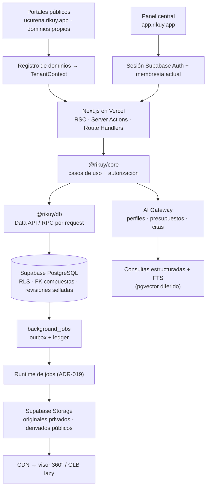

# Arquitectura de Rikuy

Resumen operativo de la arquitectura aprobada. Las decisiones completas están en los [ADRs](adr/README.md). Este documento condensa la auditoría y la propuesta SaaS elaboradas en septiembre de 2026 sobre el sistema anterior (Ucureña Explorer); esos informes completos se conservan fuera del repositorio; lo que se conserva del sistema anterior y en qué fase se cubre está en [paridad funcional](paridad-funcional.md).

## 1. Qué es

Rikuy es una plataforma **SaaS multi-tenant** de turismo inmersivo. Cada municipio (tenant) tiene su portal con su marca, dominio, contenidos, tours 360°, modelos 3D, mapa y guía con IA, y lo administra desde un panel central. Todos los municipios corren sobre **el mismo build**: dar de alta uno nuevo no requiere cambiar código (requisito ZC-01).

## 2. Vista general

## 3. Monorepo

| Ruta              | Responsabilidad                                                                              |
| ----------------- | -------------------------------------------------------------------------------------------- |
| `apps/web`        | Next.js: portal público por tenant, panel de administración, BFF y gateway de IA interactivo |
| `apps/worker`     | Procesadores de jobs durables (panoramas, GLB, ingestión de conocimiento)                    |
| `packages/core`   | Dominio, casos de uso y contratos. Framework-free                                            |
| `packages/db`     | Adaptadores de datos (Supabase), clientes por request, mapeos                                |
| `packages/ui`     | Componentes presentacionales compartidos                                                     |
| `packages/config` | Contrato de variables de entorno (Zod)                                                       |
| `supabase/`       | Migraciones, tests de RLS (pgTAP) y seed sintético — desde P1 Paso 2                         |

## 4. Tenancy y dominios (ADR-003, ADR-015)

- **Un proyecto Supabase por ambiente**, no por municipio. Tablas compartidas con `tenant_id` + RLS.
- Portal por host: `{municipio}.{dominio-plataforma}` o dominio propio verificado (TXT + CNAME → SSL en Vercel). Mientras no haya dominio de plataforma se usan alias `*.vercel.app` registrados como hosts exactos.
- Panel de administración solo en el host central; cookies host-only, sin `Domain=` compartido.
- Resolución: normalizar host → buscar en `tenant_domains` (activo y verificado) → `TenantContext` inmutable por request. Desconocido → 404; base de datos caída → 503. Nunca adivinar.
- Implementación (`apps/web/src/proxy.ts`): solo se lee la cabecera `Host`; `X-Forwarded-Host` y cualquier `X-Tenant-*`/`X-Rikuy-*` entrante se ignoran o eliminan. Cada petición se reescribe a una ruta interna según su superficie — `/admin`, `/platform` o `/portal/{host}` — de modo que esas rutas no pueden alcanzarse directamente. El contexto viaja a la página en una cabecera interna validada y se contrasta con el host de la ruta. Caché por instancia: 60 s para hosts conocidos, 10 s para desconocidos, nunca para errores.

### Marca por tenant (white-label)

- La presentación pública de cada municipio (`TenantPresentation`: identidad, tema, contacto, redes, SEO) es **dato versionado** en `tenant_config_versions`: un borrador editable con concurrencia optimista y versiones selladas inmutables. Publicar sella la versión, mueve `tenants.active_config_id` y audita, en una transacción.
- El tenant elige solo modo + dos colores; la paleta completa se deriva y se exige contraste WCAG AA al guardar. La base revalida la forma del JSON, de modo que ni el RPC directo admite HTML, CSS o URLs no https.
- El portal lee la versión activa por id (anónimo) y la guarda en caché por id: una versión sellada nunca cambia, y el id forma parte de toda clave de caché.

### Alta de municipios y miembros

- El **operador de plataforma** (`platform_operators`, separado de las membresías) actúa solo con segundo factor: toda verificación de operador exige `aal2` en el JWT.
- Alta = una transacción: tenant en `provisioning` + dominio de plataforma + puntero canónico + propietario invitado + auditoría. Pasa a `active` solo cuando el propietario aceptó (la base lo exige). Ningún dato del municipio vive en el código (ZC-01).
- La cuenta de una persona invitada la crea un adaptador aislado con la clave secreta (`src/server/identity-admin.ts`, único módulo que puede importarla), siempre después de autorizar al que invita. Las personas entran con código por correo y aceptan la invitación en el panel.
- Propietarios gestionan todos los roles; administradores, solo editores y analistas. Un municipio activo conserva siempre un propietario activo.

## 5. Acceso a datos (ADR-016)

`UI → caso de uso → autorización → repositorio`. Lecturas públicas devuelven solo la revisión publicada. Ediciones con `expected_revision` (concurrencia optimista). Publicar = sellar revisión + mover puntero + auditoría + outbox en **una** transacción RPC. Excepciones enumeradas: subida directa a Storage con capacidad firmada, adaptador de Auth, repositorio restringido del worker y health checks.

## 6. Esquema piloto (21 tablas, por fase)

| Fase                    | Tablas                                                                                                     |
| ----------------------- | ---------------------------------------------------------------------------------------------------------- |
| P1                      | `tenants`, `tenant_domains`, `memberships`, `tenant_config_versions`, `audit_events`, `platform_operators` |
| P3 (con assets básicos) | `content_items`, `content_revisions`, `assets`, `asset_versions`, `media_references`                       |
| P2                      | `background_jobs`, `job_attempts`, `usage_buckets`                                                         |
| P4                      | `tours`, `tour_revisions`, `tour_scenes`, `hotspots`                                                       |
| P5                      | `knowledge_chunks`, `ai_requests`, `ai_executions`, `copilot_proposals`                                    |

Roles piloto: `owner`, `admin`, `editor`, `analyst`. Operador de plataforma separado y con MFA. Las tablas del modelo maduro (gastronomía, transporte, campañas, billing, analytics detallada) quedan diferidas a las expansiones E1–E4.

## 7. Storage

- Buckets por ambiente: `media-originals` (privado) y `media-public` (solo derivados publicados).
- Rutas: `{tenant_id}/{asset_id}/{version}/{variante}` — nunca nombres de municipio.
- Subida directa desde el navegador con URL firmada emitida por un caso de uso; los binarios no pasan por el BFF.
- Derivados inmutables con caché larga en CDN; despublicar no revoca copias ya descargadas.
- Ciclo de una imagen (P3 · Paso 1): `create_image_upload` reserva la versión (`uploading`) y la política de Storage solo deja escribir ese `original` exacto → el navegador sube con la URL firmada → el servidor lee los bytes reales (firma PNG/JPEG/WebP, peso, dimensiones), genera derivados sin metadatos con sharp y marca `ready` (o `rejected` y borra el original) → al publicar la marca, el adaptador con clave secreta copia solo los derivados a `media-public`. SVG no se acepta (puede contener scripts).

## 7 bis. Trabajos durables (ADR-014, ADR-019)

- `background_jobs` es outbox y ledger: la transacción que acepta una operación inserta el trabajo (idempotente por municipio + tipo + clave lógica). La base es la fuente de verdad y el reloj.
- El ejecutor reclama con arrendamiento y número de _fencing_; latidos, puntos de control y resultados solo se aceptan con el número vigente. Reintentos con espera exponencial; agotados o permanentes → cola de fallidos, con reintento auditado por un operador.
- Concurrencia global por cola y por municipio controlada al reclamar, atendiendo primero a quien tiene menos trabajos en curso.
- El ejecutor es el rol `rikuy_worker` (conexión directa por el _pooler_): sin permisos sobre tablas, solo `worker_api`. Nunca `service_role` ni la sesión de una persona.
- La base despierta al ejecutor (`POST /api/jobs/drain` del host de la plataforma) con `pg_net` al encolar y con `pg_cron` cada minuto de respaldo, con un secreto propio guardado en Vault ([ADR-025](adr/ADR-025-job-runner-wake-up.md)). El endpoint responde 202 y drena después de responder.
- Procesadores en `apps/worker` (funciones sobre `@rikuy/core`); el ejecutor de turno es un adaptador. Detalle operativo en el [runbook](jobs.md).

## 8. Medios: panoramas y 3D (ADR-017, ADR-020)

- **Photo Sphere Viewer** se conserva; los hotspots se guardan en yaw/pitch (radianes), independientes de cómo se entregue la imagen.
- Pipeline: original privado → validación → preview borroso (~20–40 KB) → entrega según resolución:
  - ancho ≤ 4096 px: una imagen WebP de alta calidad;
  - ancho > 4096 px: tiles equirectangulares multirresolución (límite de textura de GPUs móviles).
- Manifest versionado por `asset_version`; cambiar la entrega nunca mueve hotspots.
- Implementado en P2 · Paso 3: el navegador sube el original (≤ 50 MB, 2048 × 1024 a 16384 × 8192 px) con URL firmada, `submit_panorama` lo pasa a `processing` y encola `media.process_panorama` en la misma transacción; el ejecutor genera todo bajo `{tenant}/{asset}/{version}/panorama/` (bucket privado, con punto de control por nivel) y guarda el manifiesto en `asset_versions.manifest`. Las versiones quedan privadas hasta que un tour publicado las use (P4).
- GLB: original intacto + derivado optimizado (Meshopt/Draco, texturas KTX2) con verificación de color; carga solo al abrir el hotspot.
- Implementado en P2 · Paso 4 ([ADR-026](adr/ADR-026-glb-pipeline.md)):
  - el navegador sube el GLB (≤ 50 MB) y `submit_model` encola `media.process_model`;
  - el ejecutor valida (JSON, validador de Khronos, archivos externos, extensiones, complejidad), codifica cada textura en KTX2 según su uso y la verifica decodificándola (ETC1S → UASTC → original), comprime la geometría con Meshopt y comprueba materiales y colores por vértice;
  - escribe `{tenant}/{asset}/{version}/model/model.glb` (privado) y el manifiesto;
  - la imagen poster la captura el panel con el mismo visor three.js del portal.

- Tours (P4 · Paso 1, [ADR-028](adr/ADR-028-tours-model.md)): un tour opcional por destino o evento, con revisiones selladas. `tour_revisions.entry_scene_id` es la única escena de entrada, y una FK compuesta la obliga a ser una escena de la misma revisión. `tour_scenes` usa un `scene_id` estable entre revisiones y guarda la vista inicial en radianes. Las ediciones son RPC por intención con el número de edición del borrador. El recorrido general del portal se forma con los tours publicados; no es un tour aparte.

- Puntos de los tours (P4 · Paso 2, [ADR-029](adr/ADR-029-tour-hotspots.md)): `tour_hotspots` y `tour_hotspot_images`.
  - Cuatro tipos (información, otra escena, modelo 3D, otro recorrido), cada uno con exactamente su destino, en yaw/pitch.
  - Ediciones parciales por intención y `hotspot_id` estable entre revisiones.
  - «Ir a otro recorrido» apunta al contenido y se resuelve al abrirlo.
  - El aspecto de los puntos es compartido entre panel y portal y se arma sin HTML.

- Publicación de tours (P4 · Paso 3, [ADR-030](adr/ADR-030-tour-publication.md)):
  - los medios del tour (teselas incluidas) se copian dentro de Storage al bucket público **antes** de sellar;
  - la revisión sellada guarda un manifiesto público inmutable;
  - `portal_tour` y `portal_tour_index` son las únicas lecturas del visitante;
  - una versión se marca publicada después de copiar sus archivos, así la cuota cuenta las copias.

## 8 bis. Cuotas por municipio (ADR-012, ADR-027)

- Dos recursos en `usage_buckets`:
  - almacenamiento (original + derivados, sin período);
  - procesamiento de medios (segundos por mes, en la zona horaria del municipio).
- Por defecto: 300 MB y 30 min al mes. Los cambia un operador con segundo factor, con auditoría.
- **Reserva atómica** al pedir una subida (trigger en `asset_versions`, un `UPDATE` condicional sobre la fila del período). Lo que no cabe se rechaza con `PT507` antes de crear nada.
- **Liquidación:**
  - al quedar lista, publicarse o recibir su poster, la versión se mide en `storage.objects`;
  - al rechazarse, se libera;
  - al terminar un trabajo de medios, el cómputo se liquida con la duración de sus intentos.
- Panel: «Uso del plan» para los miembros del municipio; `/plataforma/cuotas` para el operador.

## 9. Mapa y ubicación del visitante (ADR-021, ADR-023)

- Mapa del portal: MapLibre con teselas vectoriales de OpenFreeMap; el estilo es configuración (`NEXT_PUBLIC_MAP_STYLE_URL`). La librería se carga solo donde hay mapa (`/mapa` y, en las fichas, cuando el visitante llega al mapa pequeño); su _worker_ se sirve desde `/vendor/maplibre-gl/<versión>/`. El panel usa Leaflet + OpenStreetMap (uso ligero).
- La página del mapa trae los lugares de la zona del municipio (`portal_map_places`, tope por petición, caché por municipio y zona redondeada a ~1 km); mientras la vista queda dentro de esa zona, el navegador filtra lo que ya tiene. Solo una vista fuera de ella vuelve a preguntar al servidor, y **nunca** una vista que sigue al visitante (revelaría dónde está). Junto al mapa, la lista con los mismos lugares es la alternativa accesible; si el mapa no carga, la página sigue funcionando.
- Coordenadas de destinos y eventos en `geography(Point,4326)` con índice GiST; «cerca de» y consultas por área en el servidor.
- Posición del visitante solo en el navegador (P3 · Paso 6): se pide tras pulsar «Usar mi ubicación», `watchPosition` mientras la página está visible (se detiene al ocultarla), punto y círculo de precisión, «Seguirme», distancia en línea recta y tiempo estimado, orden por cercanía y «Estás cerca de…» con la página abierta (radio por municipio en la marca, 150 m por defecto). Las reglas son código puro de `@rikuy/core` (`domain/geo/proximity`); en la pestaña solo se recuerda que se activó, nunca la posición.
- La posición exacta nunca se envía ni se guarda; al asistente llega redondeada (~100 m) en la petición que la necesita, sin registrarse. Sin permiso, todo funciona (RC-06).

## 10. IA (ADR-018 + cierre P0 + ADR-022)

- Gateway propio con perfiles por caso de uso; proveedor intercambiable sin tocar módulos.
- Datos vigentes (eventos, horarios, ubicaciones) por **consultas estructuradas**; narrativa por **FTS en español**. Embeddings y búsqueda híbrida se activan solo si superan a FTS en evaluación.
- Respuestas con citas verificables, abstención cuando falta evidencia y presupuesto por tenant. Si la IA falla, catálogo, mapa y tours siguen funcionando.
- **Asistente del visitante** (ADR-022): una sola conversación con contexto de página, tour/escena/hotspot y ubicación redondeada; «qué hay cerca», «plan para hoy» y «ruta sugerida» desde un motor determinista; persona (nombre, saludo, tono) configurada por cada municipio en su marca; voz con dictado por cuota y lectura del navegador. La conversación vive en el dispositivo; el servidor no guarda su texto.
- Copilot V1 (leer/analizar) y V2 (proponer borradores con diff) para el personal del municipio. Publicar o enviar comunicaciones nunca es automático.

## 11. Ambientes

| Ambiente   | Web                             | Datos                           | Notas                                 |
| ---------- | ------------------------------- | ------------------------------- | ------------------------------------- |
| Local      | `pnpm dev` (`*.localhost:3000`) | Supabase CLI en Docker          | Seed sintético + `seed-assets/` local |
| Preview    | Vercel Preview por PR           | Proyecto de desarrollo          | Datos ficticios                       |
| Producción | Vercel                          | Proyecto Supabase de producción | Solo tras el gate correspondiente     |
