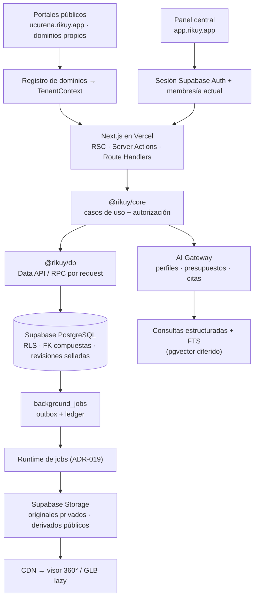

# Arquitectura de Rikuy

Resumen operativo de la arquitectura aprobada. Las decisiones completas están en los [ADRs](adr/README.md). Este documento condensa la auditoría y la propuesta SaaS elaboradas en septiembre de 2026 sobre el sistema anterior (Ucureña Explorer); esos informes completos se conservan fuera del repositorio.

## 1. Qué es

Rikuy es una plataforma **SaaS multi-tenant** de turismo inmersivo. Cada municipio (tenant) tiene su portal con su marca, dominio, contenidos, tours 360°, modelos 3D, mapa y guía con IA, y lo administra desde un panel central. Todos los municipios corren sobre **el mismo build**: dar de alta uno nuevo no requiere cambiar código (requisito ZC-01).

## 2. Vista general

## 3. Monorepo

| Ruta              | Responsabilidad                                                                              |
| ----------------- | -------------------------------------------------------------------------------------------- |
| `apps/web`        | Next.js: portal público por tenant, panel de administración, BFF y gateway de IA interactivo |
| `apps/worker`     | Procesadores de jobs durables (panoramas, GLB, ingestión de conocimiento)                    |
| `packages/core`   | Dominio, casos de uso y contratos. Framework-free                                            |
| `packages/db`     | Adaptadores de datos (Supabase), clientes por request, mapeos                                |
| `packages/ui`     | Componentes presentacionales compartidos                                                     |
| `packages/config` | Contrato de variables de entorno (Zod)                                                       |
| `supabase/`       | Migraciones, tests de RLS (pgTAP) y seed sintético — desde P1 Paso 2                         |

## 4. Tenancy y dominios (ADR-003, ADR-015)

- **Un proyecto Supabase por ambiente**, no por municipio. Tablas compartidas con `tenant_id` + RLS.
- Portal por host: `{municipio}.{dominio-plataforma}` o dominio propio verificado (TXT + CNAME → SSL en Vercel). Mientras no haya dominio de plataforma se usan alias `*.vercel.app` registrados como hosts exactos.
- Panel de administración solo en el host central; cookies host-only, sin `Domain=` compartido.
- Resolución: normalizar host → buscar en `tenant_domains` (activo y verificado) → `TenantContext` inmutable por request. Desconocido → 404; base de datos caída → 503. Nunca adivinar.
- Implementación (`apps/web/src/proxy.ts`): solo se lee la cabecera `Host`; `X-Forwarded-Host` y cualquier `X-Tenant-*`/`X-Rikuy-*` entrante se ignoran o eliminan. Cada petición se reescribe a una ruta interna según su superficie — `/admin`, `/platform` o `/portal/{host}` — de modo que esas rutas no pueden alcanzarse directamente. El contexto viaja a la página en una cabecera interna validada y se contrasta con el host de la ruta. Caché por instancia: 60 s para hosts conocidos, 10 s para desconocidos, nunca para errores.

### Marca por tenant (white-label)

- La presentación pública de cada municipio (`TenantPresentation`: identidad, tema, contacto, redes, SEO) es **dato versionado** en `tenant_config_versions`: un borrador editable con concurrencia optimista y versiones selladas inmutables. Publicar sella la versión, mueve `tenants.active_config_id` y audita, en una transacción.
- El tenant elige solo modo + dos colores; la paleta completa se deriva y se exige contraste WCAG AA al guardar. La base revalida la forma del JSON, de modo que ni el RPC directo admite HTML, CSS o URLs no https.
- El portal lee la versión activa por id (anónimo) y la guarda en caché por id: una versión sellada nunca cambia, y el id forma parte de toda clave de caché.

### Alta de municipios y miembros

- El **operador de plataforma** (`platform_operators`, separado de las membresías) actúa solo con segundo factor: toda verificación de operador exige `aal2` en el JWT.
- Alta = una transacción: tenant en `provisioning` + dominio de plataforma + puntero canónico + propietario invitado + auditoría. Pasa a `active` solo cuando el propietario aceptó (la base lo exige). Ningún dato del municipio vive en el código (ZC-01).
- La cuenta de una persona invitada la crea un adaptador aislado con la clave secreta (`src/server/identity-admin.ts`, único módulo que puede importarla), siempre después de autorizar al que invita. Las personas entran con código por correo y aceptan la invitación en el panel.
- Propietarios gestionan todos los roles; administradores, solo editores y analistas. Un municipio activo conserva siempre un propietario activo.

## 5. Acceso a datos (ADR-016)

`UI → caso de uso → autorización → repositorio`. Lecturas públicas devuelven solo la revisión publicada. Ediciones con `expected_revision` (concurrencia optimista). Publicar = sellar revisión + mover puntero + auditoría + outbox en **una** transacción RPC. Excepciones enumeradas: subida directa a Storage con capacidad firmada, adaptador de Auth, repositorio restringido del worker y health checks.

## 6. Esquema piloto (21 tablas, por fase)

| Fase                    | Tablas                                                                                                     |
| ----------------------- | ---------------------------------------------------------------------------------------------------------- |
| P1                      | `tenants`, `tenant_domains`, `memberships`, `tenant_config_versions`, `audit_events`, `platform_operators` |
| P3 (con assets básicos) | `content_items`, `content_revisions`, `assets`, `asset_versions`, `media_references`                       |
| P2                      | `background_jobs`, `job_attempts`, `usage_buckets`                                                         |
| P4                      | `tours`, `tour_revisions`, `scenes`, `hotspots`                                                            |
| P5                      | `knowledge_chunks`, `ai_requests`, `ai_executions`, `copilot_proposals`                                    |

Roles piloto: `owner`, `admin`, `editor`, `analyst`. Operador de plataforma separado y con MFA. Las tablas del modelo maduro (gastronomía, transporte, campañas, billing, analytics detallada) quedan diferidas a las expansiones E1–E4.

## 7. Storage

- Buckets por ambiente: `media-originals` (privado) y `media-public` (solo derivados publicados).
- Rutas: `{tenant_id}/{asset_id}/{version}/{variante}` — nunca nombres de municipio.
- Subida directa desde el navegador con URL firmada emitida por un caso de uso; los binarios no pasan por el BFF.
- Derivados inmutables con caché larga en CDN; despublicar no revoca copias ya descargadas.

## 8. Medios: panoramas y 3D (ADR-017, ADR-020)

- **Photo Sphere Viewer** se conserva; los hotspots se guardan en yaw/pitch (radianes), independientes de cómo se entregue la imagen.
- Pipeline: original privado → validación → preview borroso (~20–40 KB) → entrega según resolución:
  - ancho ≤ 4096 px: una imagen WebP de alta calidad;
  - ancho > 4096 px: tiles equirectangulares multirresolución (límite de textura de GPUs móviles).
- Manifest versionado por `asset_version`; cambiar la entrega nunca mueve hotspots.
- GLB: original intacto + derivado optimizado (Meshopt/Draco, texturas KTX2) con verificación de color; carga solo al abrir el hotspot.

## 9. IA (ADR-018 + cierre P0)

- Gateway propio con perfiles por caso de uso; proveedor intercambiable sin tocar módulos.
- Datos vigentes (eventos, horarios, ubicaciones) por **consultas estructuradas**; narrativa por **FTS en español**. Embeddings y búsqueda híbrida se activan solo si superan a FTS en evaluación.
- Respuestas con citas verificables, abstención cuando falta evidencia y presupuesto por tenant. Si la IA falla, catálogo, mapa y tours siguen funcionando.
- Copilot V1 (leer/analizar) y V2 (proponer borradores con diff). Publicar o enviar comunicaciones nunca es automático.

## 10. Ambientes

| Ambiente   | Web                             | Datos                           | Notas                                 |
| ---------- | ------------------------------- | ------------------------------- | ------------------------------------- |
| Local      | `pnpm dev` (`*.localhost:3000`) | Supabase CLI en Docker          | Seed sintético + `seed-assets/` local |
| Preview    | Vercel Preview por PR           | Proyecto de desarrollo          | Datos ficticios                       |
| Producción | Vercel                          | Proyecto Supabase de producción | Solo tras el gate correspondiente     |
